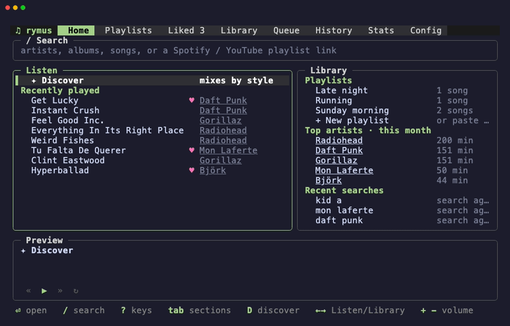
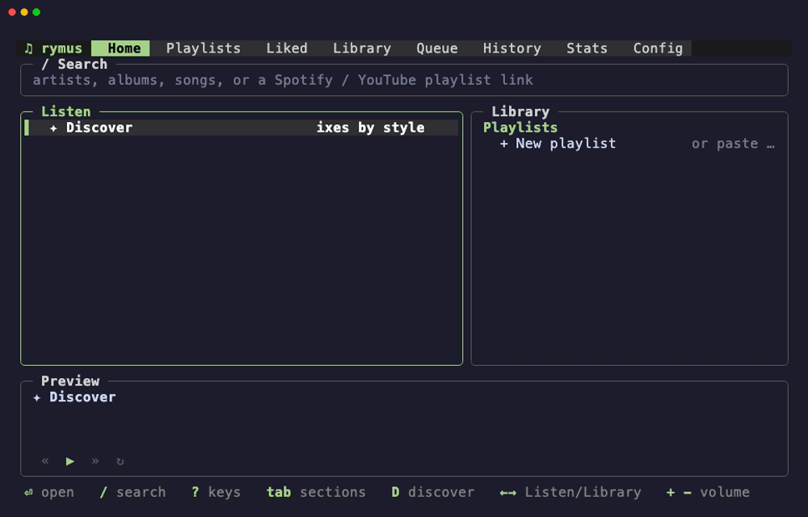
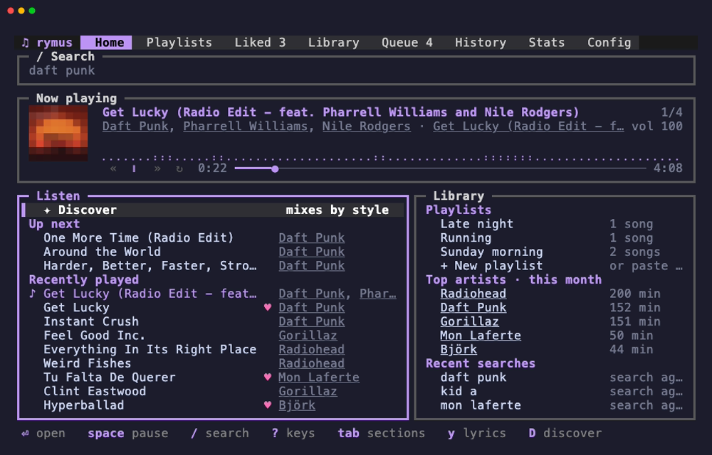

# rymus

**YouTube Music in your terminal.** Search, play, read along, and see what you listen to — without an account, without a browser tab, without leaving the keyboard.


## Why rymus

- **Nothing to sign in to.** It uses YouTube Music anonymously. Your likes, playlists and history live in one file on your computer; the services it talks to get only what each request needs (see [Your data](#your-data)).
- **Light.** A single small binary drawing text, with `mpv` playing the music. No browser, no Electron, no ads, no video eating your battery.
- **Made for the keyboard.** Every action is one key away, and the bar at the bottom always says which keys work right now. The mouse works too.
- **Yours.** A fixed color or the cover's, the player on top or below, four border styles.
- **It looks good in any terminal size.** From a small split pane to a full screen, every view rearranges itself instead of breaking.
- **It learns from you, and tells you.** Discover and the radio rank new songs by your own listening; Stats shows the minutes, not a mystery score.
- **More than a player.** Synced lyrics, karaoke, album and artist pages, a This is … playlist for any artist, crossfade, loudness levelling, a spectrum visualizer and a psychedelic one.

## What it looks like

### Albums: the cover beside the songs
Open an album and its songs are on the left, the cover and details on the right. ▶ Play album plays it in order, ⤮ Shuffle in any order.


### Lyrics and karaoke
`y` shows the lyrics, highlighting the line being sung; scroll ahead with `↑` `↓` and they come back to the song on their own. `Y` turns them into karaoke: the line being sung in big braille letters, the ones around it small, and four dots that fill up until the next line.


### Home and Stats
Home puts what to play (resume, Discover, up next, recently played) beside your library (playlists, top artists, recent searches). Stats ranks songs, artists and albums by the minutes you actually listened, with a chart of each day and of the hours you listen at.



### Settings that matter, nothing more
Crossfade, even out loudness, a data saver, pixel art covers — each changed with `←` `→` and kept for next time.



### Make it yours
The color can follow the cover of what plays, or stay the one you pick. The player can sit under the lists or above them, and the frames can be rounded, square, heavy or double. All of it is in Config, under Look, and changes the moment you press `←` `→`.


| As it comes | Purple, player on top, heavy | White, double lines |
|---|---|---|
|  |  |  |

### Any size
In a small window Home becomes one column, every list keeps its headings in sight, and nothing spills over the edges.


### And for fun
`V` opens a full screen visualizer that moves with the music, after the Windows Media Player visualizations people remember: Battery's endless feedback tunnels, Alchemy's shapes that turn into each other, Ambience's slow clouds, and the classic bars and waves. Twelve scenes with odd names ("my tornado is resting", "spider in the bathtub"). Each song opens on its own scene and moves to another on its strong moments, never in its first 15 s and at most every 30 s. `[` `]` change the scene, `.` holds it, `y` shows the sung line. It never flashes.

<sub>These recordings are made with [VHS](https://github.com/charmbracelet/vhs) from the scripts in [`tapes/`](tapes), on a fresh database with made-up history. In a terminal with the kitty graphics protocol (Ghostty, kitty, WezTerm) covers are sharp images; in the recordings they are coloured blocks.</sub>

ymus rewritten in Rust. The original JavaScript version is frozen in the [`js`](https://github.com/Skryensya/rymus/tree/js) branch; both share the same data: rymus keeps it in `~/.rymus` and leaves a link at the old `~/.ymus`, which it moves there on its first run.

## Install

Needs `mpv`, `yt-dlp` and `ffmpeg`. Developed on macOS with Ghostty, and runs on Linux.

On a Mac with Apple silicon, download the binary from [Releases](https://github.com/Skryensya/rymus/releases). It is not signed, so macOS may need `xattr -d com.apple.quarantine rymus` before the first run.

To build it yourself you need a Rust toolchain:

```sh
brew install mpv yt-dlp ffmpeg
git clone https://github.com/Skryensya/rymus.git
cd rymus
cargo install --path .
rymus
```

Cover images use the kitty graphics protocol (Ghostty, kitty, WezTerm) and fall back to coloured blocks elsewhere. Icons are Nerd Font glyphs; run `YM_PLAIN=1 rymus` without them.

## A quick tour

1. Press `/`, type an artist or a song, press `Enter`.
2. `↑` `↓` to move, `Enter` to play or open. `Esc` goes back.
3. `Space` pauses, `n` / `p` skip, `+` / `-` change the volume.
4. `y` shows the lyrics, `Y` turns them into karaoke, `v` shows the big cover.
5. `Tab` walks through Home, Playlists, Liked, Queue, Stats, Config and EQ.
6. `?` lists every key. `q` quits.

## Keys

| Key | Action |
|---|---|
| **Moving** | |
| `↑` `↓` · `PgUp` `PgDn` · `g` `End` | move · a page · top, bottom |
| `Enter` / `Shift Space` | open or play the highlighted row |
| `Esc` | back |
| `Tab` / `Shift Tab` | next / previous tab |
| `←` `→` | on Home: Listen or Library · in Stats: songs, artists, albums · in Config: change a setting |
| **Playing** | |
| `Space` | play or pause |
| `n` `p` | next, previous |
| `Shift ←` `Shift →` | seek 10 s |
| `+` `-` | volume |
| **Songs** | |
| `l` `x` | like, dislike |
| `a` | add to the queue |
| `m` | actions menu (play next, go to artist, start radio…) |
| `s` `d` | add to a playlist, remove from it |
| `R` | radio from the highlighted row |
| `D` | Discover |
| **Views** | |
| `/` | search (`⌥⌫` erases a word, `Ctrl U` everything) |
| `y` | lyrics: they follow the song; scroll with `↑` `↓` and they follow again 4 s later |
| `Y` | karaoke: the line being sung in big letters, the one before and after small, 3 dots filling up until the next |
| `v` | full player with the big cover |
| `r` | repeat: the whole queue (album, playlist), this song, off |
| `V` | trip: a full screen visualizer that follows the song · `[` `]` scene · `.` hold · `y` lyrics |
| `w` | visualizer on or off |
| `t` | in Stats: week, month, year |
| `?` | all keys |
| `q` / `Q` | quit / quit and leave the music playing |

## The screens

**Home** has two columns. *Listen*: resume where you left off, Discover, what plays next and what you played recently. *Library*: your playlists, your top artists this month and your recent searches. On a narrow screen it is one column. Each section keeps its name in sight and scrolls on its own.

**Search and pages.** A search shows artists, albums and songs. Playing a song from the results plays it and then songs like it. An **album page** has the songs on the left and the cover on the right, with the album's details under it; *▶ Play album* plays it in order and *⤮ Shuffle* in any order. An **artist page** shows their popular songs and albums; *✦ This is …* puts together their most played songs when you press `Enter` on it.

**Queue.** What you add yourself (`a`, or *Play next*) always plays before the rest, and stays when you play something else. `J` `K` move a song, `d` removes it. Albums and playlists play in their own order; songs from a search are followed by a radio that tops the queue up as it runs out.

**Playlists.** `+ New playlist` creates an empty one. To import one, press `/`, paste its link and press `Enter`. Only public (or unlisted) playlists can be read, since there is no account. Spotify gives only the first 100 songs, each looked up on YouTube Music, so a few may not be found. Importing is a one time copy.

**Stats** ranks your songs, artists and albums by minutes listened (never by play counts) over the last week, month or year, with a chart of each day (or month) and of the hours you listen at, when the screen has room.

**Config** holds the settings in groups (Sound, Streaming, Screen, Look, Output, Data), each with all its choices in view. `↑` `↓` choose one, `←` `→` or `Enter` change it, and what it does is explained beside the list (with a picture of the overlap for Crossfade). Everything is kept for next time:

| Setting | What it does |
|---|---|
| Crossfade | the end of each song plays over the start of the next, one fading out as the other fades in (off, 2–12 s). A song you pick yourself starts at once |
| Even out loudness | quiet and loud songs play at a similar level |
| Audio quality | *data saver* streams the smallest audio |
| Pixel art covers | draws every cover as coloured blocks, even where the terminal can show the image |
| Visualizer | the wave in the player (also `w`) |
| Visualizer style | *dots* rising from the bottom, solid *bars*, a *line* of dots, or a *mirror* growing up and down from the middle |
| Color | *from cover* takes the accent from what plays; or always green, blue, purple, pink, orange, yellow, red or white |
| Player | *bottom* under the lists, or *top* above them (a very short window always keeps it at the bottom) |
| Borders | rounded, square, heavy or double frames, the player's buttons included |
| Pause on output change | pauses when headphones are unplugged (macOS) |

**Lyrics** come from LRCLIB and are kept on disk, so a song you play again has them at once, even offline. All of them together stay under 10 MB (about 3 000 songs); past that, the ones you used longest ago are dropped. "No lyrics" is asked again after a month, since LRCLIB keeps adding them. With `y` you read and scroll them; synced lyrics highlight the line being sung. With `Y` they become karaoke: the line being sung in big braille letters (accents included), the one before and the one after small, and four dots under it that start empty and fill one by one, in equal steps, so they are all full just before the next line. Lines in scripts the braille font does not have are shown as plain text.

## Leaving it playing

`q` quits and stops the music. `Q` quits and leaves it playing; run `rymus` again to control it. Meanwhile the queue plays to its end, but the radio is not topped up and those listens are not counted in Stats. Closing the terminal window stops the music, like `q`.

`Ctrl R` (or `Cmd Shift R` in Ghostty and kitty) restarts `rymus` without stopping the music, which is how to pick up a freshly built version.

## Equalizer

The **EQ** tab (`E`, or `Tab` past Config). On the left the profiles (Flat, Bass boost, Vocal, Rock and more): moving through them changes the sound at once, and each one says in words what it does ("More bass and treble"). On the right a slider per band on a ±12 dB scale, with the bass, mids and treble ranges marked under them. `→` or `Enter` goes onto the sliders: `← →` band, `↑ ↓` gain, `0` back to 0 dB, `Esc` back to the profiles; the band you are on says what it moves ("62 Hz · Bass: the weight of the kick drum and the bass guitar"). Moving a slider of a built-in profile saves your change as a copy ("My Rock"), so the built-in ones stay as they are. `n` makes a new profile from what you hear, `d` deletes one of yours. Boosts lower the overall level by as much, so they never distort.

## Hooks

Run your own commands on what happens. Put an executable in `~/.rymus/hooks/` named after the event:

| Hook | When | Extra fields |
|---|---|---|
| `liked` | you like a song | |
| `unliked` | you remove the like, or dislike a liked song | |
| `disliked` | you dislike a song | |
| `playlist-add` | you add one song to a playlist | `playlist` |
| `playlist-remove` | you remove a song from a playlist | `playlist` |
| `playing` | a song starts | |
| `played` | it reaches its end | `seconds`, `duration` |
| `skipped` | you move on before its end | `seconds`, `duration` |

Each gets one JSON object on its standard input:

```json
{"event": "liked", "id": "…", "url": "https://music.youtube.com/watch?v=…", "title": "…", "artist": "…", "album": "…", "cover": "…"}
```

For example:

```sh
#!/bin/sh
jq -r '.artist + " - " + .title + " " + .url' >> ~/liked-songs.txt
```

Then `chmod +x ~/.rymus/hooks/liked`. Hooks run in the background and are not stopped when you quit. What they print goes to `~/.rymus/hooks.log`, and rymus tells you if one fails.

- Playback hooks only run while `rymus` is open (not while the music plays on after `Q`), and a song on repeat reports its end only when it stops repeating.
- Importing a playlist, saving a whole queue as one, or deleting a playlist runs nothing.
- Two events close together may finish in either order.

## Your data

Likes, history, playlists and settings stay in `~/.rymus/rymus.db` (`YM_DB` points it elsewhere). In Config, under **Data**: *Export your data…* writes all of it as CSV files (one per table: tracks, likes, plays, playlists…) in a new folder any spreadsheet opens, *Import data…* replaces everything with such a folder, and *Wipe all data…* deletes it all (you type `delete all my data` to confirm); rymus then starts empty, as on its first run. The services used receive only what a request needs:

- **YouTube Music**: your searches and the songs you play or ask recommendations for
- **Spotify**: the id of a playlist you paste
- **LRCLIB**: title, artist, album and length, when you open lyrics
- **MusicBrainz / ListenBrainz**: artist names and ids, for Discover and radio

---

## How it works

Four kinds of thread send messages to one main loop, and only the main loop touches the app's state:

```
 keyboard and mouse ─┐
 mpv events ─────────┤
 network answers ────┼──▶  main loop  ──▶  App::handle(msg)   change the state
 audio output ───────┘    (main.rs)        App::tick()        every 40 ms: what moves by itself
                                           App::render()      the whole screen as one string
                                                │
                                                └──▶ only the lines that changed are written
```

- **mpv** plays the music. It runs headless and is driven over its IPC socket (`mpv.rs`); `yt-dlp` finds the audio of each song. The spectrum analyser runs inside mpv's own audio filter and sends its measurements back through a pipe (`viz.rs`).
- **Anything slow** (a search, an album, lyrics, a cover) runs on its own thread and comes back as a message carrying a closure that updates the state (`Msg::Apply`). The screen never waits on the network.
- **Drawing** is one function, `App::render`, that builds every line at exactly the terminal's width, step by step (sizes, colour, bars, the open view, the player, the hints, images). Along the way it records where each list was drawn, so a click can find the row under it.
- **Your data** is a SQLite file (`db.rs`). Stats and recommendations are computed from the log of what you heard.

## Where things are

Every file starts with a comment saying what it does. `src/main.rs` lists them all, grouped.

```
src/
├── main.rs          start, terminal setup, the main loop
├── app/             the App: state and behaviour, one file per topic
│   ├── mod.rs           the App struct and the small types around it (Tab, Msg, Action…)
│   ├── input.rs         every message arrives here; keys and mouse
│   ├── clock.rs         the 40 ms tick
│   ├── navigation.rs    tabs, going back, what each row does, the m menu
│   ├── lists.rs         which list is on screen; loading Home, Stats, the tabs
│   ├── pages.rs         search, albums, artists, mixes (everything that waits on the network)
│   ├── player.rs        mpv's events, the settings it applies, the queue it plays
│   ├── radio.rs         similar songs that keep the queue going
│   ├── playlists.rs     making, filling, renaming, importing playlists
│   └── media.rs         lyrics and covers, cached for the session
├── render/          the screen, one file per view
│   ├── mod.rs           render(): the whole screen, step by step
│   ├── rows.rs          list rows, and the generic list view (with an album's cover)
│   ├── home.rs · stats.rs · words.rs (lyrics, karaoke) · player.rs (dock, full player)
│   ├── album.rs         the album page's cover column
│   ├── images.rs        real images through the kitty protocol
│   └── help.rs          the hints line and the ? page
├── item.rs          one row of any list
├── mpv.rs · yt.rs · lyrics.rs · playlist.rs · cover.rs · output.rs · platform.rs    the outside world
├── db.rs · config.rs · recommend.rs · mixes.rs                                      your data and taste
├── ui.rs · theme.rs · home.rs · charts.rs · bigtext.rs · viz.rs · scenes.rs · trip.rs   the look
└── flows.rs         behaviour tests
```

## Making changes

**A new key.** Add it to `command_key` in `src/app/input.rs`, then list it in `hint_list` and `HELP` in `src/render/help.rs` so people can find it.

**A new setting.** Add a line to `SETTINGS` in `src/config.rs` (its first choice is the default), then say what it does in `apply_setting` in `src/app/player.rs`. It shows up in the Config tab and is saved on its own.

**A new kind of row.** Add a `Kind` in `src/item.rs`, then say what `Enter` does with it in `open_action` (`src/app/navigation.rs`).

**A new view.** Add a branch to step 4 of `render` in `src/render/mod.rs`, in its own file under `src/render/`. Every row must be exactly as wide as the screen; the tests check this at many sizes.

**The README's GIFs.** They are recorded from the scripts in `tapes/` with VHS; see [`tapes/README.md`](tapes/README.md). Record again after a change that shows.

## Tests

```sh
cargo test
```

No network, sound or real `mpv`, and your database is not touched. Most tests check one piece. `src/flows.rs` drives the whole app with keys and clicks against a made up YouTube Music and a player that only records its orders, and checks what ends up on screen at several terminal sizes. The tests give the same result in any terminal. When you change a behaviour on purpose, change its test with it.

## Benchmark

`python3 bench/bench.py <command> [<command>…]` compares builds in a pseudo terminal, with audio output off. For example `python3 bench/bench.py ./target/release/rymus`.

## Notes

An unofficial project, not affiliated with or endorsed by YouTube or Google. Inspired by [involvex/youtube-music-cli](https://github.com/involvex/youtube-music-cli).

MIT license.
