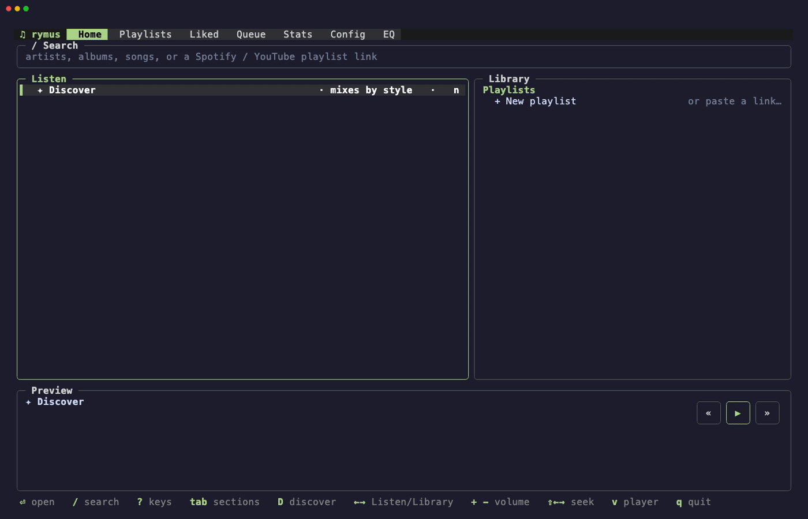
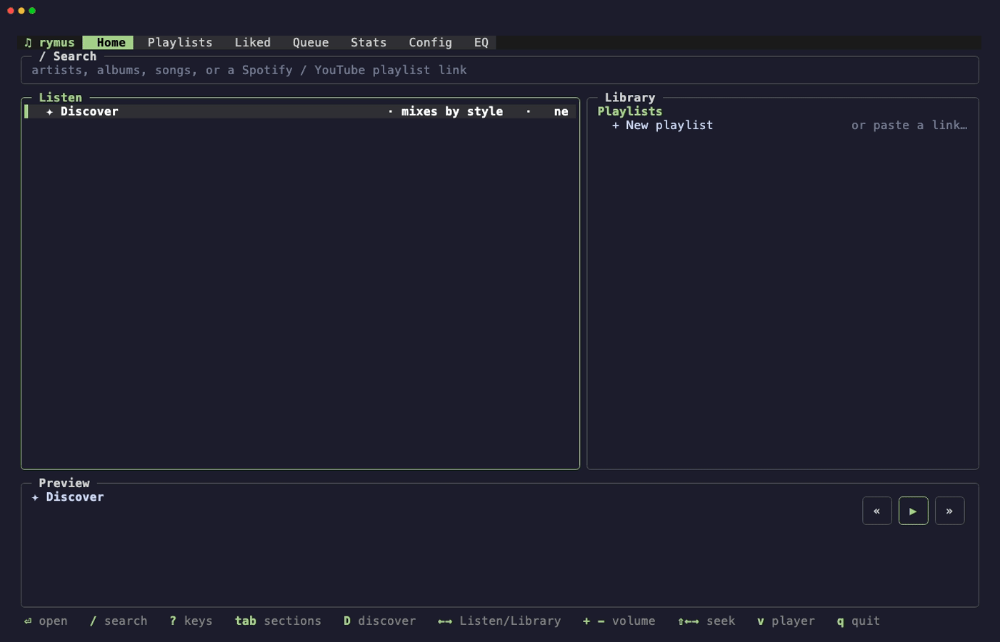
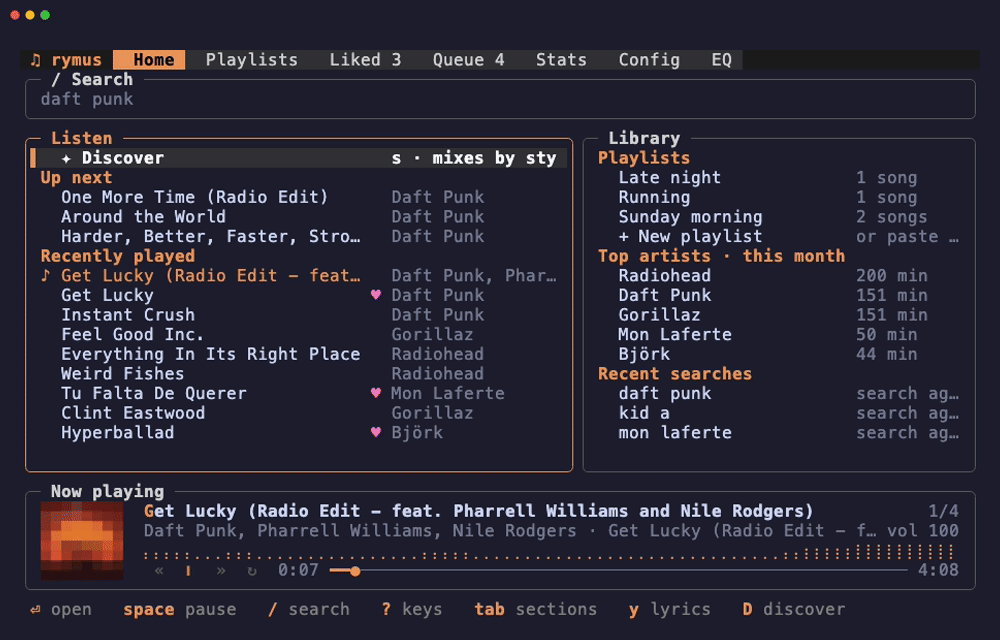
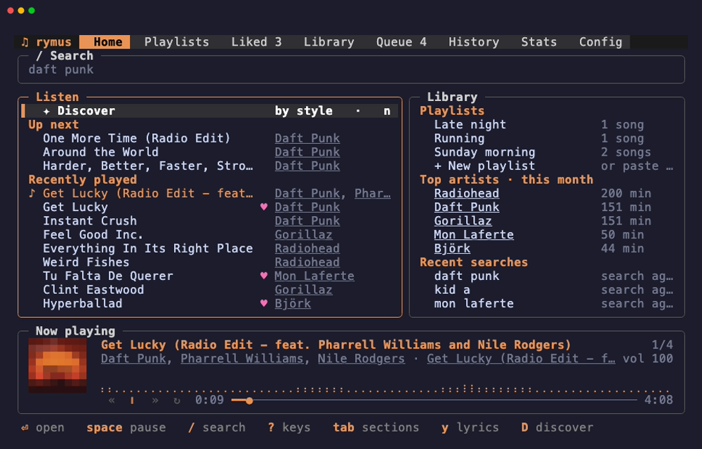
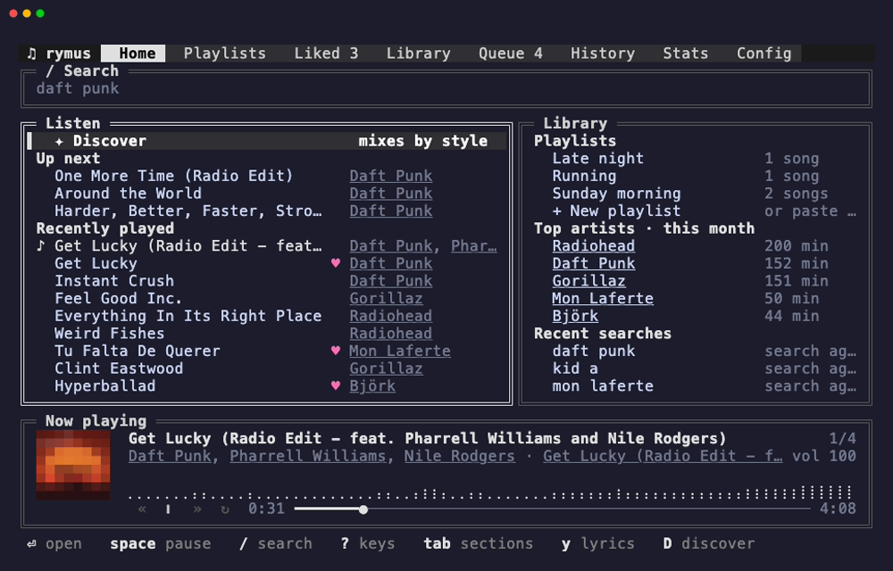
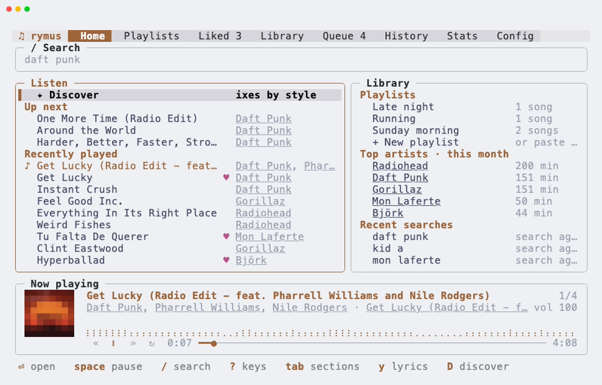
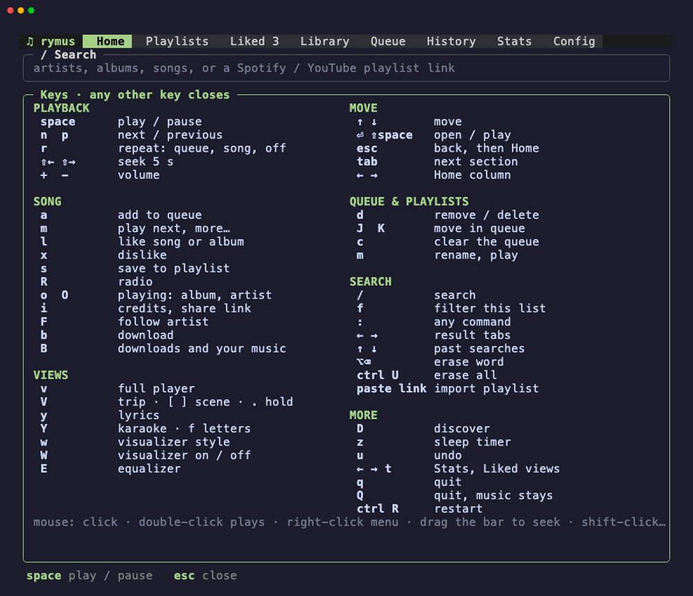

# rymus

**rymus** is **R**ust **Y**ouTube **Mu**sic, with an **s** on the end: YouTube Music in the terminal, without a browser, an account or ads, with your likes and history kept on your own computer.

I wrote it to listen from the terminal I already live in, and it is built around how I listen. It is public in case it is useful to someone else, but it is not a product: there is no roadmap, no support promise, and things move around.



## What it does

- **Plays YouTube Music without signing in.** Searches, albums, artists and radios come from YouTube Music anonymously; `mpv` and `yt-dlp` do the playing.
- **Stays on the keyboard.** Every action is a key, the bottom line shows the keys that work right now, `?` lists them all and `:` finds any command by name. The mouse works too.
- **Keeps what you like.** Liked songs and albums, artists you follow with their new releases, playlists (also imported from a Spotify or YouTube link), and downloads to listen offline, next to your own music files.
- **Shows what you actually listen to.** Stats counts minutes, not plays; History lists every song by day; Discover and the radio rank new songs by your own listening.
- **Tells you who made it.** Credits for any song or album (performers, writers, producers, label), and its link to share.
- **The extras.** Synced lyrics and karaoke, an equalizer, crossfade, mono, a sleep timer, a full-screen visualizer after the Windows Media Player ones, hooks to run your own scripts, and English or Spanish (or any language added with a CSV).
- **Fits any pane, and any taste.** From a narrow split to a full screen; light or dark, with the accent of the cover or a fixed color, the player above or below, ten kinds of frame.

## What it looks like

### Search, artists and albums
Results come in tabs (songs, albums, artists), ordered by how well they match what you typed. An album page has its songs on the left and the cover on the right; ▶ Play album plays it in order, ⤮ Shuffle in any order.



### Lyrics and karaoke
`y` shows the lyrics, following the line being sung. `Y` turns them into karaoke: the sung line in big letters, the lines around it small, and four dots that fill up until the next one.


### Home and Stats
Home puts what to play next beside your library. Stats ranks songs, artists and albums by the minutes you really listened, with a chart per day and per hour.


### Config
Five sections on the left. `↑` `↓` go through them, each shown as it is reached; `→` goes into one, `←` `→` change a setting, `Esc` comes back out.


### The look
Dark or light mode, the accent from the cover or a fixed color, the player above or below the lists, and ten kinds of frame (one of them ornate, in plain ASCII). All in Config → Look.



| As it comes | Purple, player on top, heavy | White, double lines |
|---|---|---|
|  |  |  |

| Light mode | Light, teal, player on top, square |
|---|---|
|  |  |

### Any size
In a small window Home becomes one column and every list keeps its headings in sight.


<sub>Recorded with [VHS](https://github.com/charmbracelet/vhs) from the scripts in [`tapes/`](tapes), on a fresh database with made-up history. In a terminal with the kitty graphics protocol (Ghostty, kitty, WezTerm) covers are sharp images; in the recordings they are coloured blocks.</sub>

## Install

rymus needs `mpv`, `yt-dlp` and `ffmpeg`. I use it on macOS with Ghostty; it also runs on Linux. Windows is not something I test or plan for.

**A Mac with Apple silicon:** download the latest archive from [Releases](https://github.com/Skryensya/rymus/releases).

```sh
brew install mpv yt-dlp ffmpeg
tar -xzf rymus-v*-aarch64-apple-darwin.tar.gz
cd rymus-v*-aarch64-apple-darwin
xattr -d com.apple.quarantine rymus 2>/dev/null   # the binary is not signed
./rymus
```

**From source** (any Mac or Linux, with a Rust toolchain):

```sh
git clone https://github.com/Skryensya/rymus.git
cd rymus
cargo install --path .
```

Covers are real images in terminals with the kitty graphics protocol (Ghostty, kitty, WezTerm) and coloured blocks elsewhere. Icons are Nerd Font glyphs; `YM_PLAIN=1 rymus` runs without them.

### Updates

Once a day rymus asks GitHub for the name of its latest release (nothing about you is sent) and, when there is a newer one, says so with a note. **Config → General → Update** installs it, or `rymus update` in a terminal: the new binary is downloaded, checked against its sha256, and put in place of the old one. `Cmd Shift R` (or `Ctrl R`) then restarts into it without stopping the music. *Check for updates: off* never asks.

The first time a new version opens, a small panel shows what changed; `o` opens the full release on GitHub.

## A quick tour

1. Press `/`, type an artist or a song, press `Enter`.
2. `↑` `↓` to move, `Enter` to play or open, `Esc` to go back.
3. `Space` pauses, `n` / `p` skip, `+` / `-` change the volume.
4. `y` shows the lyrics, `i` who made the song, `v` the big player.
5. `Tab` walks through Home, Playlists, Liked, Library, Queue, History, Stats and Config.
6. `?` lists every key. `q` quits.

## Keys

`?` shows them all, grouped, from anywhere:



| Key | Action |
|---|---|
| **Moving** | |
| `↑` `↓` · `PgUp` `PgDn` · `g` `End` | move · a page · top, bottom |
| `Enter` / `Shift Space` | open or play the highlighted row |
| `Esc` | back, then Home |
| `Tab` / `Shift Tab` | next / previous tab |
| `←` `→` | Home's columns · search result tabs · Stats' and Liked's views · a setting in Config |
| **Playing** | |
| `Space` | play or pause |
| `n` `p` | next, previous |
| `Shift ←` `Shift →` | seek 5 s |
| `+` `-` | volume |
| `r` | repeat: the whole queue, this song, off |
| `z` | sleep timer |
| **Songs and albums** | |
| `l` `x` | like, dislike (`l` on an album likes all of it) |
| `a` | add to the queue |
| `m` | the row's menu: play next, go to artist or album, credits, share, download… |
| `s` `d` | add to a playlist, remove from it |
| `R` | radio from the highlighted row |
| `i` | credits; `s` there copies the link |
| `o` `O` | the playing song's album, artist |
| `F` | follow an artist |
| `b` `B` | download, the Downloads window |
| `D` | Discover |
| **Views** | |
| `/` | search (`⌥⌫` erases a word, `Ctrl U` everything) |
| `f` · `:` | filter this list · any command by name |
| `y` `Y` | lyrics, karaoke (`f` changes the letters) |
| `v` | full player with the big cover |
| `V` | trip, a full-screen visualizer · `[` `]` scene · `.` hold · `y` lyrics |
| `w` `W` | next visualizer style (dots, bars, line, mirror) · visualizer on or off |
| `E` | equalizer |
| `u` | undo the last removal |
| `?` | all keys |
| `q` / `Q` | quit / quit and leave the music playing |
| `Ctrl R` | restart, the music going on |

**Mouse:** click selects, double-click plays, right-click opens the row's menu, the bar seeks when dragged, and names in the player and lists are links to their artist or album. **Shift+click on a cover** shows it as large as the terminal allows.

## Using it

### Search
Results come in three tabs, **Songs**, **Albums** and **Artists** (`←` `→`, or click), and more load as you reach the end of a tab. They are ordered by how well they answer what you typed, not by plays: the title or name you wrote first, then longer ones, with remixes, live versions and covers last unless you ask for them. Playing a song from the results plays it and then songs like it.

An **album page** has the songs on the left and the cover on the right, with the album's details under it. An **artist page** shows their popular songs and albums; *✦ This is …* puts together their most played songs.

### Home, Liked and Library
**Home** has two columns. *Listen*: resume where you left off, Discover, what plays next and what you played recently. *Library*: your playlists, your top artists this month and your recent searches. On a narrow screen it is one column, each section keeping its name in sight.

**Liked** holds your liked songs; `←` `→` groups them by album. `l` on an album (in search results, on an artist's page, or on an album page's Play and Shuffle buttons) likes every song of it, leaving out the ones you disliked; on a liked album, `l` asks before taking those likes back.

**Library** keeps the albums you like, with the cover beside the list. `F` follows an artist (on their row or page): albums they put out from then on show there as **New releases**, checked at most twice a day. Only albums are noticed, not singles. `d` removes an album or artist, after asking.

### Queue and playlists
What you add yourself (`a`, or *Play next*) always plays before the rest, and stays when you play something else. `J` `K` move a song, `d` removes it, `c` removes the radio's songs or all but what plays. Albums and playlists play in their own order; songs from a search are followed by a radio that tops the queue up as it runs out.

`+ New playlist` creates an empty one. To import one, press `/`, paste its link and press `Enter`. Only public (or unlisted) playlists can be read, since there is no account. Spotify gives only the first 100 songs, each looked up on YouTube Music, so a few may not be found. Importing is a one-time copy.

`u` takes back what you just removed: songs from the queue, a playlist, a song in one, an album's likes.

### Lyrics and karaoke
Lyrics come from LRCLIB and are kept on disk, so a song you play again has them at once, even offline. All of them together stay under 10 MB (about 3 000 songs); past that, the ones used longest ago go first. A song LRCLIB has no lyrics for is asked again after a month.

With `y` you read them; synced lyrics follow the line being sung, `↑` `↓` scroll ahead and they come back on their own 4 s later. With `Y` they become karaoke: the line being sung in big letters (`f` cycles dots, solid and blocks), the one before and after small, and four dots that fill one by one, so they are all full just before the next line. Lines in scripts the big font does not have are shown as plain text.

### Credits and sharing
`i` shows who made the highlighted song or album, or the one playing from the full player: performers, writers, producers and label, as YouTube Music lists them. An album's are those of all its songs together, with its year, length and description. A music video has no credits of its own, so rymus shows those of the song with the same title.

In that panel `s` copies the YouTube Music link to the clipboard; the row's menu has *Credits* and *Share link* too. The clipboard is `pbcopy` on macOS, and `wl-copy`, `xclip` or `xsel` on Linux.

### Stats and History
**Stats** ranks your songs, artists and albums by minutes listened over the last week, month or year (`t`), with a chart of each day and of the hours you listen at when the screen has room. **History** lists what you heard, by day.

### Sound
- **Crossfade** (Config → Sound): the end of each song plays over the start of the next, one fading out as the other fades in, for 2 to 12 s. A song you pick yourself starts at once.
- **Even out loudness**: quiet and loud songs play at a similar level.
- **Channels**: stereo, or mono (left and right mixed, the same on both sides), switched without a gap.
- **Equalizer** (`E` from anywhere, or Config → Sound): a window over whatever you are looking at. On the left the built-in profiles (Flat, Bass boost, Vocal, Rock and more) and yours; moving through them changes the sound at once, and each says what it does. On the right a slider per band on a ±12 dB scale. `→` goes onto the sliders: `←` `→` band, and on a profile of yours `↑` `↓` gain and `0` back to 0 dB. `n` makes a profile of yours from what you hear, `r` resets it to the one it came from, `d` deletes it. Boosts lower the overall level by as much, so they never distort.

### Config
Settings are in five sections. Everything is kept for next time.

| Section | Settings |
|---|---|
| **Sound** | Crossfade · Even out loudness · Channels · Equalizer… · Audio quality (*data saver* streams the smallest audio) · Pause on output change (when headphones are unplugged, on macOS) |
| **Look** | Mode (*dark* or *light*, to match your terminal: a pale accent is darkened to stay readable) · Color (*from cover*, or always one of 13) · Player (*bottom* or *top*) · Borders (rounded, square, heavy, double, dashed, dotted, deco, block, ascii, or ornate: `@-~=*=~` along the edges and `{ }` down the sides) |
| **Screen** | Pixel art covers (blocks even where the terminal shows images) · Visualizer · Visualizer style |
| **Downloads** | Keep offline · File format · Your own music · Downloads and your music… |
| **General** | Language · Check for updates · Update · Export your data… · Import data… · Delete all my data… |

### Offline and your own music
`b` downloads the highlighted song (every song, from an album's Play and Shuffle buttons), or what plays; `m` → *Download* does the same. A downloaded song is marked `↓` and plays from its file, with or without network; `m` → *Delete download* removes it.

**The Downloads window** (`B` from anywhere, or Config → Downloads) shows the folder, the room it takes, how many songs are downloaded and how many are on their way. There you set *Keep offline* (`liked songs` downloads every new like), *File format* (mp3, m4a, opus or original) and *Your own music*, change the folder (`~/Music/rymus` by default), download what plays or all your liked songs, and free up space.

Files are named `Artist - Title [id].mp3`, and each comes with what other players read beside it: its lyrics (`.lrc` when synced, `.txt` when not), its cover (`.jpg`, large) and a thumbnail (`.thumb.jpg`). A song on disk shows the lyrics from its file, without network.

**Your own music:** with it on, rymus reads the same folder (subfolders too). Every audio file it did not download (mp3, flac, m4a, opus, ogg, wav…) shows in **Library → Your music** and plays from disk, with the equalizer and crossfade. Name files `Artist - Title.flac` and the artist shows; the folder becomes the album.

**Free up space…** asks what share to delete (1 to 100 %, typed; from 90 % it asks again), then shows how many songs and how much space go before deleting. The least played of the songs rymus downloaded go first. Your own files are never deleted.

Downloading needs `yt-dlp` and `ffmpeg`; what you may download and keep is up to you and YouTube's terms.

### Media keys and `rymus ctl`
The keyboard's play/pause, next and previous keys, AirPods and the system's Now Playing work with rymus through mpv: on macOS out of the box, on Linux once the [mpv-mpris](https://github.com/hoyon/mpv-mpris) plugin is installed.

`rymus ctl play-pause`, `next`, `prev`, `volume-up`, `volume-down`, `like` (like what plays, or take the like back) and `status` (one line such as `▶ Title — Artist`, for tmux or a status bar) control the rymus that is playing from outside it: a keyboard shortcut, or buttons of your own on a MacBook's Touch Bar with [MTMR](https://github.com/Toxblh/MTMR) or BetterTouchTool. Give those apps the full path, e.g. `/opt/homebrew/bin/rymus ctl play-pause`: they do not read your shell's `PATH`.

### Leaving it playing
`q` quits and stops the music. `Q` quits and leaves it playing; run `rymus` again to take it back. Meanwhile the queue plays to its end, but the radio is not topped up and those listens are not counted in Stats. Closing the terminal window stops the music, like `q`. `Ctrl R` (or `Cmd Shift R` in Ghostty and kitty) restarts rymus without stopping the music, on the tab you were on.

## Make it yours

### Languages
rymus speaks English and Spanish: Config → General → Language. `rymus help` and `rymus man` follow the same choice.

To add a language, or change any word:

```sh
rymus translations > ~/.rymus/translations.csv
```

Open it in any spreadsheet. Each row is one text: the `english` column says what it is, and every other column is a language. Add a column (`français`, `português`…) and fill in what you want; an empty cell stays in English, and `{name}` is a value rymus puts in, so keep it as it is. Save it as CSV in the same place and restart rymus (`Ctrl R`): the new column shows up in Language. Your file goes on top of the built-in one (`lang/translations.csv`), so you can also correct a single word. When rymus gets new texts, run the command again into another file to see them.

### Hooks
Run your own commands on what happens. Put an executable in `~/.rymus/hooks/` named after the event:

| Hook | When | Extra fields |
|---|---|---|
| `liked` | you like a song (once per song when you like an album) | |
| `unliked` | you remove the like, or dislike a liked song | |
| `disliked` | you dislike a song | |
| `playlist-add` | you add one song to a playlist | `playlist` |
| `playlist-remove` | you remove a song from a playlist | `playlist` |
| `playing` | a song starts | |
| `played` | it reaches its end | `seconds`, `duration` |
| `skipped` | you move on before its end | `seconds`, `duration` |
| `download-started` | a song starts downloading | `folder`, `format`, `waiting` (songs after it) |
| `downloaded` | a song's file is ready | `path`, `format`, and the files saved with it: `cover` (large), `thumbnail`, `lyrics` (each `null` when there is none) |
| `download-failed` | a download did not work | `error` (yt-dlp's last line) |
| `download-deleted` | a downloaded file is deleted | `path`, `files` (the song and its cover, thumbnail and lyrics), `bytes`, `reason`: `you` or `free up space` |

Each gets one JSON object on its standard input:

```json
{"event": "liked", "id": "…", "url": "https://music.youtube.com/watch?v=…", "title": "…", "artist": "…", "album": "…", "cover": "…"}
```

For example, `~/.rymus/hooks/liked`:

```sh
#!/bin/sh
jq -r '.artist + " - " + .title + " " + .url' >> ~/liked-songs.txt
```

Then `chmod +x ~/.rymus/hooks/liked`. Hooks run in the background and are not stopped when you quit. What they print goes to `~/.rymus/hooks.log`, and rymus tells you if one fails.

- Playback hooks only run while rymus is open (not while the music plays on after `Q`), and a song on repeat reports its end only when it stops repeating.
- Importing a playlist, saving a whole queue as one, or deleting a playlist runs nothing.
- Two events close together may finish in either order.
- A song of your own music has `url: null` and its file in `path`. Your own files are never deleted, so they never get `download-deleted`.

### Help and manual
`rymus help` (or `--help`) lists the commands and keys. `rymus man` opens the full manual. To have `man rymus` too:

```sh
rymus man > "$(brew --prefix)/share/man/man1/rymus.1"   # Linux: ~/.local/share/man/man1/rymus.1
```

Run it again after updating.

## Your data

Likes, history, playlists and settings stay in `~/.rymus/rymus.db` (`YM_DB` points it elsewhere). In Config → General:

- *Export your data…* writes all of it as CSV files (one per table: tracks, likes, plays, playlists…) in a new folder any spreadsheet opens. Texts a spreadsheet would run as formulas are written so they show as text.
- *Import data…* replaces everything with such a folder.
- *Delete all my data…* erases it all (you type `delete all my data` to confirm); rymus then starts empty, as on its first run.

The services used receive only what a request needs:

- **YouTube Music**: your searches and the songs you play, ask credits for or ask recommendations for
- **Spotify**: the id of a playlist you paste
- **LRCLIB**: title, artist, album and length, when you open lyrics or download a song
- **MusicBrainz / ListenBrainz**: artist names and ids, for Discover and radio
- **GitHub**: the name of the latest release, once a day (off in Config → General), its notes once after an update, and the download when you update

rymus started as `ymus`, in JavaScript; this is the Rust rewrite, hence the name. The JavaScript version is frozen in the [`js`](https://github.com/Skryensya/rymus/tree/js) branch. Both share the same data: rymus keeps it in `~/.rymus` and leaves a link at the old `~/.ymus`.

---

## How it works

Four kinds of thread send messages to one main loop, and only the main loop touches the app's state:

```
 keyboard and mouse ─┐
 mpv events ─────────┤
 network answers ────┼──▶  main loop  ──▶  App::handle(msg)   change the state
 audio output ───────┘    (main.rs)        App::tick()        every 40 ms: what moves by itself
                                           App::render()      the whole screen as one string
                                                │
                                                └──▶ only the lines that changed are written
```

- **mpv** plays the music. It runs headless and is driven over its IPC socket (`mpv.rs`); `yt-dlp` finds the audio of each song. The spectrum analyser runs inside mpv's own audio filter and sends its measurements back through a pipe (`viz.rs`).
- **Anything slow** (a search, an album, lyrics, a cover, credits) runs on its own thread and comes back as a message carrying a closure that updates the state (`Msg::Apply`). The screen never waits on the network.
- **Drawing** is one function, `App::render`, that builds every line at exactly the terminal's width. Along the way it records where each list was drawn, so a click can find the row under it.
- **Your data** is a SQLite file (`db.rs`). Stats and recommendations are computed from the log of what you heard.

## Where things are

Every file starts with a comment saying what it does; `src/main.rs` lists the top-level ones, grouped.

```
src/
├── main.rs          start, terminal setup, the main loop, rymus ctl / update
├── app/             the App: its state and behaviour, one file per topic
│   ├── mod.rs           the App struct and the small types around it (Tab, Msg, Action…)
│   ├── input.rs         every message arrives here; keys and mouse, the panels' keys, Config's two levels
│   ├── clock.rs         the 40 ms tick
│   ├── navigation.rs    tabs, going back, what each row does, the m menu
│   ├── lists.rs · pages.rs · search.rs     which list is on screen; search, albums, artists, mixes
│   ├── player.rs        mpv's events, the settings it applies, the queue it plays
│   ├── radio.rs · playlists.rs · albums.rs · library.rs · filter.rs · extras.rs
│   ├── media.rs         lyrics and covers, cached; the cover viewer
│   ├── credits.rs       credits and share links
│   ├── downloads.rs · equalizer.rs         their windows
│   ├── data.rs          export, import, delete all your data
│   └── updates.rs       the daily check, installing, what's new
├── render/          the screen, one file per view
│   ├── mod.rs           render(): the whole screen, step by step
│   ├── rows.rs          list rows, and the generic list view
│   ├── home.rs · stats.rs · words.rs (lyrics, karaoke) · player.rs (dock, full player) · album.rs
│   ├── config.rs · eq.rs · downloads.rs    Config and the windows
│   ├── help.rs · panels.rs                 the hints line and the ? page; credits and what's new
│   ├── viewer.rs        a cover, big
│   └── images.rs        real images through the kitty protocol
├── item.rs          one row of any list
├── mpv.rs · yt.rs · lyrics.rs · playlist.rs · cover.rs · output.rs · platform.rs · update.rs    the outside world
├── db.rs · csv.rs · disk.rs · config.rs · eq.rs · recommend.rs · mixes.rs · hooks.rs            your data and taste
├── ui.rs · theme.rs · home.rs · charts.rs · bigtext.rs · viz.rs · scenes.rs · trip.rs           the look
├── i18n.rs · manual.rs                                                                          languages, help, manual
└── flows.rs         behaviour tests
```

## Making changes

- **A new key.** Add it to `command_key` in `src/app/input.rs`, then list it in `hint_list` and `HELP` in `src/render/help.rs` so people can find it.
- **A new setting.** Add a line to `SETTINGS` in `src/config.rs` (its first choice is the default, its group the Config section), then say what it does in `apply_setting` in `src/app/player.rs`. It shows up in Config and is saved on its own.
- **A new kind of row.** Add a `Kind` in `src/item.rs`, then say what `Enter` does with it in `open_action` (`src/app/navigation.rs`).
- **A new view.** Add a branch to `render` in `src/render/mod.rs`, in its own file under `src/render/`. Every row must be exactly as wide as the screen; the tests check this at many sizes.
- **A new text.** Write it with `tr!` and add its row to `lang/translations.csv`; a test fails when one is missing.
- **The README's images.** Recorded from the scripts in `tapes/` with VHS; see [`tapes/README.md`](tapes/README.md). Record again after a change that shows.
- **A release.** Its notes start with a `## What's new` section: that is what the app shows after updating.

## Tests

```sh
cargo test
```

No network, sound or real `mpv`, and your database is not touched. Most tests check one piece. `src/flows.rs` drives the whole app with keys and clicks against a made-up YouTube Music and a player that only records its orders, and checks what ends up on screen at several terminal sizes. When you change a behaviour on purpose, change its test with it.

`python3 bench/bench.py <command> [<command>…]` compares builds in a pseudo terminal, with audio output off (it plays real songs and loads the machine: not while you listen). `RYMUS_TRACE=/tmp/trace.txt rymus` writes how long each step of starting took.

## Notes

A personal project, made for my own listening. Issues and ideas are welcome, but I build what I need. Unofficial, not affiliated with or endorsed by YouTube or Google. Inspired by [involvex/youtube-music-cli](https://github.com/involvex/youtube-music-cli).

MIT license.
