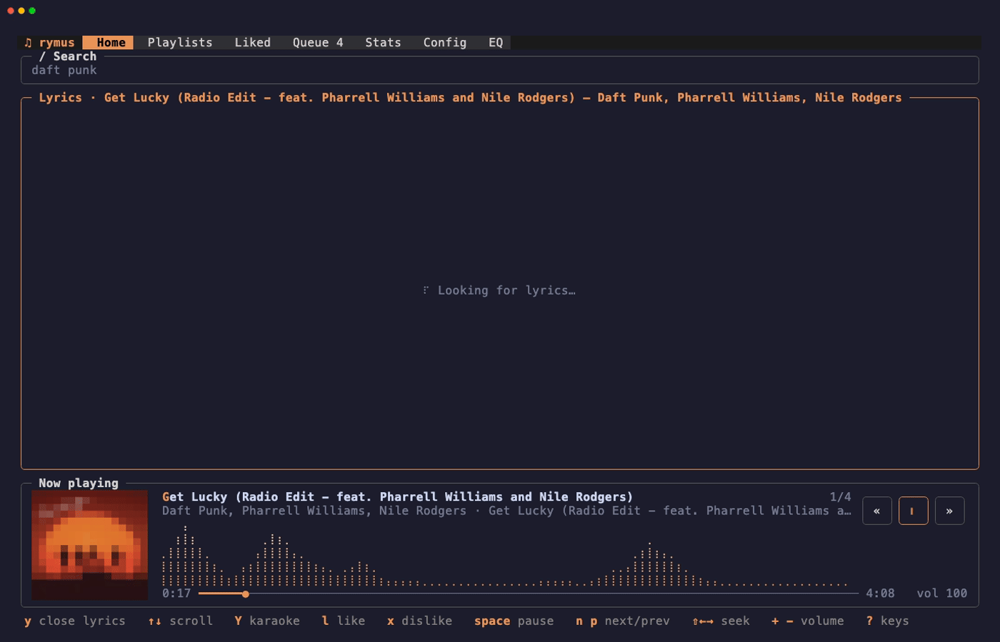
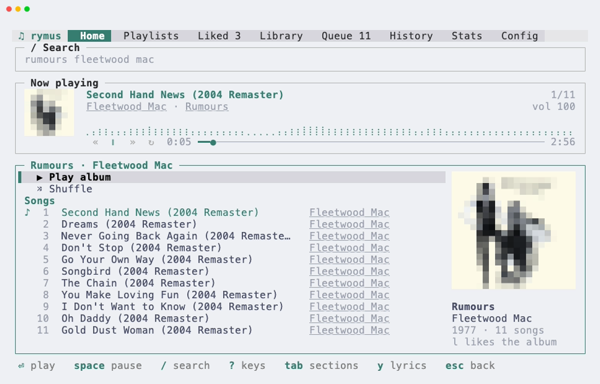
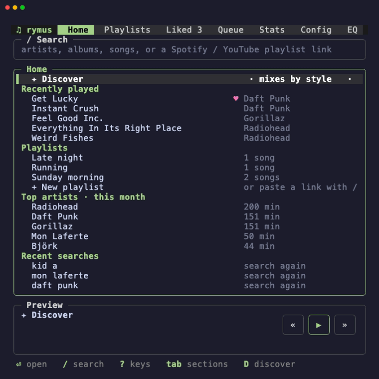

# rymus

**rymus** is **R**ust **Y**ouTube **Mu**sic, with an **s** on the end.

I wanted to listen to YouTube Music from the terminal I already live in: no browser tab, no account, no ads, and my own likes and history kept on my computer. Nothing out there did quite what I wanted, so I wrote this. It is a tool for my own use, built around how I listen, and it changes whenever I want something different. It is public in case it is useful to someone else, but it is not a product: there is no roadmap, no support promise, and things move around.


## What it does for me

- **Plays YouTube Music without signing in.** Searches, albums, artists and radios come from YouTube Music anonymously; `mpv` and `yt-dlp` do the playing. My likes, playlists and history live in one SQLite file (see [Your data](#your-data)).
- **Stays on the keyboard.** Every action is a key, the bottom line says which keys work right now, `?` lists them all and `:` finds any command by name. The mouse works too.
- **Keeps what I like.** Liked songs, liked albums (saved in Library), artists I follow with their new releases, playlists (also imported from a Spotify or YouTube link), and downloads to listen offline.
- **Shows what I actually listen to.** Stats counts minutes, not plays; History lists every song by day; Discover and the radio rank new songs by my own listening.
- **The extras I wanted.** Synced lyrics and karaoke, an equalizer, crossfade, mono, a sleep timer, a full screen visualizer after the Windows Media Player ones, hooks to run my own scripts, and English or Spanish (or any language added with a CSV).
- **Fits whatever pane I give it.** From a narrow split to a full screen, light or dark terminal.

## What it looks like

### Search, artists and albums
Results come in tabs (songs, albums, artists) ordered by what I typed. An album page has its songs on the left and the cover on the right; ▶ Play album plays it in order, ⤮ Shuffle in any order.


### Lyrics and karaoke
`y` shows the lyrics, following the line being sung; `↑` `↓` scroll ahead and they come back on their own. `Y` turns them into karaoke: the sung line in big letters (`f` changes their style), the lines around it small, and four dots that fill up until the next one.



### Home and Stats
Home puts what to play next to my library. Stats ranks songs, artists and albums by the minutes I really listened, with a chart per day and per hour.


### Config
A short list of settings, each changed with `←` `→` (or a click) and kept: the language, crossfade, loudness, mono, the equalizer (a window of its own), data saver, the look.


### The look
Dark or light mode, the accent from the cover or a fixed color, the player above or below the lists, and ten kinds of frame (one of them ornate, in plain ASCII). All in Config, under Look.


| As it comes | Purple, player on top, heavy | White, double lines |
|---|---|---|
|  |  |  |

| Light mode | Light, teal, player on top, square |
|---|---|
|  |  |

### Any size
In a small window Home becomes one column and every list keeps its headings in sight.



### The trip
`V` opens a full screen visualizer that moves with the music, made after the Windows Media Player visualizations I remember: twelve scenes with odd names, a scene of its own for each song, changes on the song's strong moments. `[` `]` change the scene, `.` holds it, `y` shows the sung line. It never flashes.

<sub>These recordings are made with [VHS](https://github.com/charmbracelet/vhs) from the scripts in [`tapes/`](tapes), on a fresh database with made-up history. In a terminal with the kitty graphics protocol (Ghostty, kitty, WezTerm) covers are sharp images; in the recordings they are coloured blocks.</sub>

It started as `ymus`, in JavaScript; this is the Rust rewrite, hence the name. The JavaScript version is frozen in the [`js`](https://github.com/Skryensya/rymus/tree/js) branch; both share the same data: rymus keeps it in `~/.rymus` and leaves a link at the old `~/.ymus`, which it moves there on its first run.

## Install

Needs `mpv`, `yt-dlp` and `ffmpeg`. I use it on macOS with Ghostty; it also runs on Linux. Windows is not something I test or plan for.

On a Mac with Apple silicon, download the binary from [Releases](https://github.com/Skryensya/rymus/releases). It is not signed, so macOS may need `xattr -d com.apple.quarantine rymus` before the first run.

To build it yourself you need a Rust toolchain:

```sh
brew install mpv yt-dlp ffmpeg
git clone https://github.com/Skryensya/rymus.git
cd rymus
cargo install --path .
rymus
```

Cover images use the kitty graphics protocol (Ghostty, kitty, WezTerm) and fall back to coloured blocks elsewhere. Icons are Nerd Font glyphs; run `YM_PLAIN=1 rymus` without them.

## A quick tour

1. Press `/`, type an artist or a song, press `Enter`.
2. `↑` `↓` to move, `Enter` to play or open. `Esc` goes back.
3. `Space` pauses, `n` / `p` skip, `+` / `-` change the volume.
4. `y` shows the lyrics, `Y` turns them into karaoke, `v` shows the big cover.
5. `Tab` walks through Home, Playlists, Liked, Library, Queue, History, Stats and Config.
6. `?` lists every key. `q` quits.

## Languages

rymus speaks English and Spanish: **Config → Language** (at the top). `rymus help` and `rymus man` follow the same choice.

To add a language, or change any word:

```sh
rymus translations > ~/.rymus/translations.csv
```

Open it in any spreadsheet. Each row is one text: the `english` column says what it is, and every other column is a language. Add a column (`français`, `português`…) and fill in what you want; an empty cell stays in English, and `{name}` is a value rymus puts in, so keep it as it is. Save it as CSV in the same place and restart rymus (`Ctrl R`): the new column shows up in Config → Language. Your file goes on top of the built-in one (`lang/translations.csv`), so you can also correct a Spanish word without touching the rest. When rymus gets new texts, run the command again into another file to see them: rows of yours are kept as long as you keep your file.

## Help and manual

`rymus help` (or `--help`) lists the commands and keys. `rymus man` opens the full manual. To have `man rymus` too:

```sh
rymus man > "$(brew --prefix)/share/man/man1/rymus.1"   # Linux: ~/.local/share/man/man1/rymus.1
```

Run it again after updating.

## Keys

| Key | Action |
|---|---|
| **Moving** | |
| `↑` `↓` · `PgUp` `PgDn` · `g` `End` | move · a page · top, bottom |
| `Enter` / `Shift Space` | open or play the highlighted row |
| `Esc` | back |
| `Tab` / `Shift Tab` | next / previous tab |
| `←` `→` | on Home: Listen or Library · in Stats: songs, artists, albums · in Config: change a setting |
| **Playing** | |
| `Space` | play or pause |
| `n` `p` | next, previous |
| `Shift ←` `Shift →` | seek 5 s |
| `+` `-` | volume |
| **Songs** | |
| `l` `x` | like, dislike |
| `a` | add to the queue |
| `m` | actions menu (play next, go to artist, start radio…) |
| `s` `d` | add to a playlist, remove from it |
| `R` | radio from the highlighted row |
| `D` | Discover |
| **Views** | |
| `/` | search (`⌥⌫` erases a word, `Ctrl U` everything) |
| `y` | lyrics: they follow the song; scroll with `↑` `↓` and they follow again 4 s later |
| `Y` | karaoke: the line being sung in big letters, the one before and after small, 3 dots filling up until the next |
| `v` | full player with the big cover |
| `r` | repeat: the whole queue (album, playlist), this song, off |
| `V` | trip: a full screen visualizer that follows the song · `[` `]` scene · `.` hold · `y` lyrics |
| `w` | visualizer on or off |
| `t` | in Stats: week, month, year |
| `?` | all keys |
| `q` / `Q` | quit / quit and leave the music playing |

## The screens

**Home** has two columns. *Listen*: resume where you left off, Discover, what plays next and what you played recently. *Library*: your playlists, your top artists this month and your recent searches. On a narrow screen it is one column. Each section keeps its name in sight and scrolls on its own.

**Search and pages.** A search shows artists, albums and songs. Playing a song from the results plays it and then songs like it. An **album page** has the songs on the left and the cover on the right, with the album's details under it; *▶ Play album* plays it in order and *⤮ Shuffle* in any order. An **artist page** shows their popular songs and albums; *✦ This is …* puts together their most played songs when you press `Enter` on it.

**Queue.** What you add yourself (`a`, or *Play next*) always plays before the rest, and stays when you play something else. `J` `K` move a song, `d` removes it. Albums and playlists play in their own order; songs from a search are followed by a radio that tops the queue up as it runs out.

**Playlists.** `+ New playlist` creates an empty one. To import one, press `/`, paste its link and press `Enter`. Only public (or unlisted) playlists can be read, since there is no account. Spotify gives only the first 100 songs, each looked up on YouTube Music, so a few may not be found. Importing is a one time copy.

**Stats** ranks your songs, artists and albums by minutes listened (never by play counts) over the last week, month or year, with a chart of each day (or month) and of the hours you listen at, when the screen has room.

**Config** holds the settings in groups (Sound, Streaming, Screen, Look, Output, Data), each with all its choices in view. `↑` `↓` choose one, `←` `→` or `Enter` change it, and what it does is explained beside the list (with a picture of the overlap for Crossfade). Everything is kept for next time:

| Setting | What it does |
|---|---|
| Crossfade | the end of each song plays over the start of the next, one fading out as the other fades in (off, 2–12 s). A song you pick yourself starts at once |
| Even out loudness | quiet and loud songs play at a similar level |
| Audio quality | *data saver* streams the smallest audio |
| Pixel art covers | draws every cover as coloured blocks, even where the terminal can show the image |
| Visualizer | the wave in the player (also `w`) |
| Visualizer style | *dots* rising from the bottom, solid *bars*, a *line* of dots, or a *mirror* growing up and down from the middle |
| Mode | *dark* or *light*, to match your terminal's background: text, tones and frames change, and a pale accent is darkened to stay readable |
| Color | *from cover* takes the accent from what plays; or always red, coral, orange, yellow, lime, green, teal, cyan, blue, purple, magenta, pink or white |
| Player | *bottom* under the lists, or *top* above them (a very short window always keeps it at the bottom) |
| Borders | rounded, square, heavy, double, dashed, dotted, deco, block, ascii, or ornate: `@-~=*=~` scrolls along the edges and `{ }` curls down the sides |
| Pause on output change | pauses when headphones are unplugged (macOS) |

**Lyrics** come from LRCLIB and are kept on disk, so a song you play again has them at once, even offline. All of them together stay under 10 MB (about 3 000 songs); past that, the ones you used longest ago are dropped. "No lyrics" is asked again after a month, since LRCLIB keeps adding them. With `y` you read and scroll them; synced lyrics highlight the line being sung. With `Y` they become karaoke: the line being sung in big letters (accents included; `f` cycles dots, solid and blocks, remembered, and a line too long for the chosen style is drawn in dots), the one before and the one after small, and four dots under it that start empty and fill one by one, in equal steps, so they are all full just before the next line. Lines in scripts the big font does not have are shown as plain text.

## Media keys

The keyboard's play/pause, next and previous keys, AirPods, and the system's Now Playing work with rymus, through mpv: on macOS out of the box, on Linux once the [mpv-mpris](https://github.com/hoyon/mpv-mpris) plugin is installed. They keep working after `Q`, while the music plays on.

`rymus ctl play-pause`, `next`, `prev`, `volume-up`, `volume-down`, `like` (like what plays, or take the like back) and `status` (one line such as `▶ Title — Artist`, for tmux or a status bar) control the rymus that is playing from outside it: a keyboard shortcut, or buttons of your own on the MacBook's Touch Bar with [MTMR](https://github.com/Toxblh/MTMR) (free) or BetterTouchTool. The system's own Touch Bar play/pause (Now Playing) already works; its volume slider is the system's, so use `volume-up`/`volume-down` for rymus' own. Make each button run the command with its full path, e.g. `/opt/homebrew/bin/rymus ctl play-pause`: those apps do not read your shell's `PATH`.

## Leaving it playing

`q` quits and stops the music. `Q` quits and leaves it playing; run `rymus` again to control it. Meanwhile the queue plays to its end, but the radio is not topped up and those listens are not counted in Stats. Closing the terminal window stops the music, like `q`.

`Ctrl R` (or `Cmd Shift R` in Ghostty and kitty) restarts `rymus` without stopping the music, which is how to pick up a freshly built version.

## Albums you like

`l` on an album (in search results, on an artist's page, or on the Play and Shuffle buttons of the album's page) likes every song of it; songs you disliked are left out. On an album that is already liked, `l` asks before removing those likes. On the **Liked** tab, `← →` switches between your likes by song and grouped by album.

In the player and in lists (search results, Stats, Home, queue and the rest), names are underlined links: an artist or album opens its page with one click. In the player you can also press `o` for the playing song's album and `O` for its artist.

## Finding things

- `f` narrows the list you are on (Liked, Library, queue, history, playlists, pages) as you type; `Enter` keeps it, `Esc` clears it.
- `:` or `Ctrl K` opens the command palette: type part of a command's name and press `Enter`.

## Library and following

Liking an album also saves it in **Library**, with its cover beside the list. `F` follows an artist (on their row or page): albums they put out from then on show there as **New releases**, checked at most twice a day. `d` removes an album or artist, after asking. Only albums are noticed, not singles.

## Offline

`b` downloads the highlighted song (every song, from an album's Play and Shuffle buttons), or what plays; `m` → *Download* does the same. A downloaded song is marked `↓` and plays from its file, with or without network; `m` → *Delete download* removes it. Downloading needs `yt-dlp` and `ffmpeg`; what you may download and keep is up to you and YouTube's terms.

**The Downloads window** (`B` from anywhere, or *Config → Downloads and your music*) sits over the screen like the equalizer. On top: the folder, the room it takes, how many songs are downloaded (and of your own), and how many are still on their way. Then, changed with `← →`: *Keep offline* (`liked songs` downloads every new like), *File format* (mp3, m4a, opus or original) and *Your own music*. Then, run with `⏎`: *Change folder…* (`~/Music/rymus` unless you choose another), *Download what plays* (also `b` in the window), *Download all liked songs* and *Free up space…*. Files are named `Artist - Title [id].mp3`.

**Your own music.** With *Your own music: on*, rymus reads the same folder (subfolders too): every audio file it did not download (mp3, flac, m4a, opus, ogg, wav…) shows in **Library → Your music** and plays from disk, with the EQ and crossfade. Name files `Artist - Title.flac` and the artist shows; the folder becomes the album.

**Free up space…** asks what share to delete, typed from 1 to 100 % (the last one is offered again), then shows how many songs and how much space go before deleting. The least played of the songs rymus downloaded go first, the oldest first among equals. Your own files are never deleted. Downloading needs `yt-dlp` and `ffmpeg`; what you may download and keep is up to you and YouTube's terms.

## While it plays

- `z` sets a sleep timer: in 15 to 90 minutes, after this song, or when this album ends.
- `c` on the queue removes the radio's songs, or all but what plays.
- `u` takes back what you just removed: songs from the queue, a playlist, a song in one, an album's likes.
- **History** lists what you heard, by day.

## Search

Results come in three tabs, **Songs**, **Albums** and **Artists** (`← →`, or click), and more load as you reach the end of a tab. They are ordered by how well they answer what you typed, not by plays: the title or name you wrote first, then longer ones, with remixes, live versions and covers last unless you ask for them.

## Mono

**Config → Channels** switches between stereo and mono (left and right mixed, the same on both sides), without a gap in the music.

## Equalizer

A window over whatever you are looking at: **Config → Equalizer**, or `E` from anywhere. On the left the built-in profiles (Flat, Bass boost, Vocal, Rock and more) and yours: moving through them changes the sound at once, and each one says in words what it does ("More bass and treble"). On the right a slider per band on a ±12 dB scale. `→` or `Enter` goes onto the sliders: `← →` band, and on a profile of yours `↑ ↓` gain and `0` back to 0 dB. The built-in profiles cannot be edited: `n` makes one of yours from what you hear. On yours, `r` resets it to the built-in one it came from and `d` deletes it (both ask first). `0` on the list goes back to Flat, and `Esc` closes. Boosts lower the overall level by as much, so they never distort.

## Hooks

Run your own commands on what happens. Put an executable in `~/.rymus/hooks/` named after the event:

| Hook | When | Extra fields |
|---|---|---|
| `liked` | you like a song (once per song when you like an album) | |
| `unliked` | you remove the like, or dislike a liked song | |
| `disliked` | you dislike a song | |
| `playlist-add` | you add one song to a playlist | `playlist` |
| `playlist-remove` | you remove a song from a playlist | `playlist` |
| `playing` | a song starts | |
| `download-started` | a song starts downloading | `folder`, `format`, `waiting` (songs after it) |
| `downloaded` | a song's file is ready | `path`, `format` |
| `download-failed` | a download did not work | `error` (yt-dlp's last line) |
| `download-deleted` | a downloaded file is deleted | `path`, `bytes`, `reason`: `you` (`m` → *Delete download*) or `free up space` |
| `played` | it reaches its end | `seconds`, `duration` |
| `skipped` | you move on before its end | `seconds`, `duration` |

Each gets one JSON object on its standard input:

```json
{"event": "liked", "id": "…", "url": "https://music.youtube.com/watch?v=…", "title": "…", "artist": "…", "album": "…", "cover": "…"}
```

For example:

```sh
#!/bin/sh
jq -r '.artist + " - " + .title + " " + .url' >> ~/liked-songs.txt
```

Then `chmod +x ~/.rymus/hooks/liked`. Hooks run in the background and are not stopped when you quit. What they print goes to `~/.rymus/hooks.log`, and rymus tells you if one fails.

- Playback hooks only run while `rymus` is open (not while the music plays on after `Q`), and a song on repeat reports its end only when it stops repeating.
- Importing a playlist, saving a whole queue as one, or deleting a playlist runs nothing.
- Two events close together may finish in either order.
- A song of your own music (Library → Your music) has `url: null` and its file in `path`; `playing`, `played`, `skipped`, `liked`… run for it as for any song. Your own files are never deleted, so they never get `download-deleted`.

## Your data

Likes, history, playlists and settings stay in `~/.rymus/rymus.db` (`YM_DB` points it elsewhere). In Config, under **Data**: *Export your data…* writes all of it as CSV files (one per table: tracks, likes, plays, playlists…) in a new folder any spreadsheet opens, *Import data…* replaces everything with such a folder, and *Wipe all data…* deletes it all (you type `delete all my data` to confirm); rymus then starts empty, as on its first run. The services used receive only what a request needs:

- **YouTube Music**: your searches and the songs you play or ask recommendations for
- **Spotify**: the id of a playlist you paste
- **LRCLIB**: title, artist, album and length, when you open lyrics
- **MusicBrainz / ListenBrainz**: artist names and ids, for Discover and radio

---

## How it works

Four kinds of thread send messages to one main loop, and only the main loop touches the app's state:

```
 keyboard and mouse ─┐
 mpv events ─────────┤
 network answers ────┼──▶  main loop  ──▶  App::handle(msg)   change the state
 audio output ───────┘    (main.rs)        App::tick()        every 40 ms: what moves by itself
                                           App::render()      the whole screen as one string
                                                │
                                                └──▶ only the lines that changed are written
```

- **mpv** plays the music. It runs headless and is driven over its IPC socket (`mpv.rs`); `yt-dlp` finds the audio of each song. The spectrum analyser runs inside mpv's own audio filter and sends its measurements back through a pipe (`viz.rs`).
- **Anything slow** (a search, an album, lyrics, a cover) runs on its own thread and comes back as a message carrying a closure that updates the state (`Msg::Apply`). The screen never waits on the network.
- **Drawing** is one function, `App::render`, that builds every line at exactly the terminal's width, step by step (sizes, colour, bars, the open view, the player, the hints, images). Along the way it records where each list was drawn, so a click can find the row under it.
- **Your data** is a SQLite file (`db.rs`). Stats and recommendations are computed from the log of what you heard.

## Where things are

Every file starts with a comment saying what it does. `src/main.rs` lists them all, grouped.

```
src/
├── main.rs          start, terminal setup, the main loop
├── app/             the App: state and behaviour, one file per topic
│   ├── mod.rs           the App struct and the small types around it (Tab, Msg, Action…)
│   ├── input.rs         every message arrives here; keys and mouse
│   ├── clock.rs         the 40 ms tick
│   ├── navigation.rs    tabs, going back, what each row does, the m menu
│   ├── lists.rs         which list is on screen; loading Home, Stats, the tabs
│   ├── pages.rs         search, albums, artists, mixes (everything that waits on the network)
│   ├── player.rs        mpv's events, the settings it applies, the queue it plays
│   ├── radio.rs         similar songs that keep the queue going
│   ├── playlists.rs     making, filling, renaming, importing playlists
│   └── media.rs         lyrics and covers, cached for the session
├── render/          the screen, one file per view
│   ├── mod.rs           render(): the whole screen, step by step
│   ├── rows.rs          list rows, and the generic list view (with an album's cover)
│   ├── home.rs · stats.rs · words.rs (lyrics, karaoke) · player.rs (dock, full player)
│   ├── album.rs         the album page's cover column
│   ├── images.rs        real images through the kitty protocol
│   └── help.rs          the hints line and the ? page
├── item.rs          one row of any list
├── mpv.rs · yt.rs · lyrics.rs · playlist.rs · cover.rs · output.rs · platform.rs    the outside world
├── db.rs · config.rs · recommend.rs · mixes.rs                                      your data and taste
├── ui.rs · theme.rs · home.rs · charts.rs · bigtext.rs · viz.rs · scenes.rs · trip.rs   the look
└── flows.rs         behaviour tests
```

## Making changes

**A new key.** Add it to `command_key` in `src/app/input.rs`, then list it in `hint_list` and `HELP` in `src/render/help.rs` so people can find it.

**A new setting.** Add a line to `SETTINGS` in `src/config.rs` (its first choice is the default), then say what it does in `apply_setting` in `src/app/player.rs`. It shows up in the Config tab and is saved on its own.

**A new kind of row.** Add a `Kind` in `src/item.rs`, then say what `Enter` does with it in `open_action` (`src/app/navigation.rs`).

**A new view.** Add a branch to step 4 of `render` in `src/render/mod.rs`, in its own file under `src/render/`. Every row must be exactly as wide as the screen; the tests check this at many sizes.

**The README's GIFs.** They are recorded from the scripts in `tapes/` with VHS; see [`tapes/README.md`](tapes/README.md). Record again after a change that shows.

## Tests

```sh
cargo test
```

No network, sound or real `mpv`, and your database is not touched. Most tests check one piece. `src/flows.rs` drives the whole app with keys and clicks against a made up YouTube Music and a player that only records its orders, and checks what ends up on screen at several terminal sizes. The tests give the same result in any terminal. When you change a behaviour on purpose, change its test with it.

## Benchmark

`python3 bench/bench.py <command> [<command>…]` compares builds in a pseudo terminal, with audio output off. For example `python3 bench/bench.py ./target/release/rymus`. It plays real songs and loads the machine: not while you listen to music.

`RYMUS_TRACE=/tmp/trace.txt rymus` writes how long each step of starting took (the first screen is up in about 5 ms; mpv takes about 200 ms to load and is reached in the background).

## Notes

A personal project, made for my own listening. Issues and ideas are welcome, but I build what I need. Unofficial, not affiliated with or endorsed by YouTube or Google. Inspired by [involvex/youtube-music-cli](https://github.com/involvex/youtube-music-cli).

MIT license.
